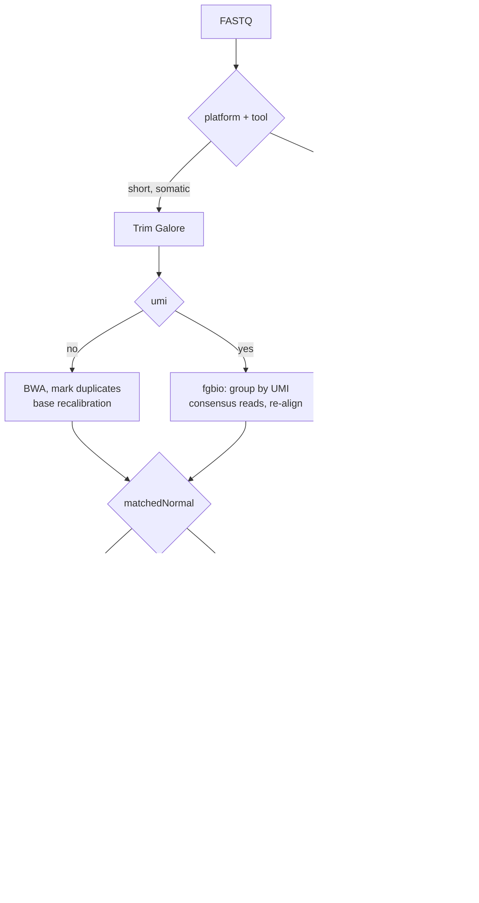

# Custom Panel Analysis

Somatic (tumour) variant analysis for **targeted gene panels** in human
samples. Reads are aligned to the human reference, variants are called only
over the panel regions, then annotated with gene effects (SnpEff). There is an
optional gene and disease report from the shared tertiary database.

## Which path runs?

| Platform | `tool` | Subworkflow | What it is for |
|---|---|---|---|
| `illumina`, `ion-torrent` | `somatic` | `SOMATIC_ANALYSIS` | Tumour panel: GATK Mutect2 (tumour-only or tumour-normal, optional UMIs) |
| `nanopore` | `somatic` | `NANOPORE_SOMATIC_ANALYSIS` | UMI-tagged amplicon panels, consensus reads, LoFreq |

## What you need

**Sample sheet** (`sampleName,pairend,fastq1,fastq2`). For tumour-normal
somatic runs, add the optional `patient_id` and `sample_type` columns so
tumours can be paired with their normals.

| Parameter | Meaning |
|---|---|
| `reference` | Human reference FASTA (BWA index built next to it if missing) |
| `bed` | Panel target regions. For nanopore somatic: **one line per amplicon** |
| `snpeffDB` | SnpEff human database (default `GRCh37.75`) |
| `dbsnp` | dbSNP VCF (known variants) |
| `tertiaryDB` | Optional shared SQLite database for gene/disease reports |
| `length`, `quality` | Trim Galore settings |
| `matchedNormal`, `germlineResource`, `pon` | Somatic: tumour-normal mode, gnomAD-style germline resource (required with `matchedNormal`), panel of normals |
| `umi`, `umiReadStructure`, `umiDuplex` | Somatic Illumina: UMI consensus mode (fgbio) |

## Pipeline flow

## Steps

### Somatic – short reads (`SOMATIC_ANALYSIS`)
1. Read counts, **Trim Galore**.
2. Either:
   - **standard:** BWA-MEM → mark duplicates → **base quality recalibration (BQSR)**, or
   - **UMI mode** (`umi=true`): fgbio groups reads by their molecular barcode and builds one consensus read per original DNA molecule. This removes PCR and sequencing errors, which makes low-frequency tumour variants easier to trust.
3. **Mutect2** – tumour-only, or tumour vs matched normal (`matchedNormal=true`), with an optional panel of normals.
4. **FilterMutectCalls**, table export, `bcftools stats`, **SnpEff**.

### Somatic – Nanopore UMI amplicons (`NANOPORE_SOMATIC_ANALYSIS`)
1. Read filtering (optional subsampling) and NanoPlot QC.
2. Map reads and **split them by amplicon**. A read counts only if it spans most of an amplicon, and amplicons with too few reads are skipped.
3. **Detect UMIs**, **cluster** reads from the same molecule, and **polish** each cluster with **Medaka** into a single high-accuracy consensus read.
4. Map the consensus reads, compute coverage, and call low-frequency variants with **LoFreq**.
5. **SnpEff** annotation.

### Tertiary report (all paths, optional)
If `tertiaryDB` is set, the annotated VCF is loaded into the shared SQLite
database and a gene / disease-association report is written for the run.

## Tools

| Tool | Version |
|---|---|
| Trim Galore | 0.6.7 |
| NanoPlot | 1.42.0 |
| BWA | 0.7.3a |
| SAMtools (alignment-tools) | 1.13 |
| GATK (MarkDuplicates, BQSR, Mutect2) | 4.2.6.1 |
| fgbio | in GATK/UMI images |
| umi-pipeline-nf tools (UMI clustering, Medaka, LoFreq) | v1.0.1 |
| bedtools | 2.31.1 |
| SnpEff / SnpSift | 5.1 |
